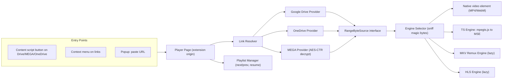

# CloudPlay: Lightweight Cloud Video Player Extension: Phased Plan

**Goal:** A cross-browser (Chrome + Firefox) Manifest V3 extension that streams video files, **MPEG-TS (`.ts`) first**, from **MEGA, Google Drive and OneDrive** share links. It needs full seeking, **next/previous playlist navigation**, and a very small footprint.

---

## 1. Guiding Principles

| Principle | What it means in practice |
|---|---|
| **Lightweight** | Vanilla TypeScript, no UI framework. Core bundle **< 150 KB gzipped**. Heavy modules load lazily. No persistent background page. |
| **Stream, never download** | Every source becomes a *range-readable byte stream*. Nothing is buffered to disk, and memory is capped by a sliding window. |
| **Pluggable** | `SourceProvider` (where bytes come from) is kept separate from `PlaybackEngine` (how bytes are decoded). Adding Dropbox later should take one file. |
| **Privacy-first** | MEGA keys never leave the device. No telemetry, no remote code (an MV3 rule), and only the minimum permissions. |
| **Cross-browser from day 1** | One codebase with per-browser manifest generation. CI tests both browsers. |

---

## 2. High-Level Architecture



### Core Interfaces (contract for all phases)

```ts
interface MediaItem {
  id: string;            // provider-scoped stable id
  name: string;
  size: number;
  mime?: string;
  provider: 'gdrive' | 'onedrive' | 'mega';
}

interface RangeByteSource {
  readonly size: number;
  read(start: number, end: number, signal: AbortSignal): Promise<ReadableStream<Uint8Array>>;
}

interface SourceProvider {
  canHandle(url: URL): boolean;
  resolve(url: URL): Promise<{ items: MediaItem[]; startIndex: number }>; // file OR folder
  open(item: MediaItem): Promise<RangeByteSource>;
}

interface PlaybackEngine {
  canPlay(probe: ProbeResult): boolean;
  attach(video: HTMLVideoElement, src: RangeByteSource): Promise<void>;
  seek(time: number): Promise<void>;
  destroy(): void;
}
```

### Why the player runs as an extension page and not as an overlay

- The host page's CSP and DOM can't interfere with it.
- `host_permissions` let it make cross-origin `fetch` calls with Range headers.
- One UI codebase works for all three providers.
- Content scripts stay tiny (about 3 KB). They only inject a "▶ Play in CloudPlay" button.

---

## 3. Key Technical Decisions & Risks

| Area | Decision | Risk / Mitigation |
|---|---|---|
| **TS playback** | Use **mpegts.js** (transmuxes TS to fMP4 into Media Source Extensions) with a **custom loader** that pulls from our `RangeByteSource`. It's about 50 KB gzipped and loads lazily. | Browsers can't play TS natively, so MSE is required. |
| **TS codecs** | Supported: H.264 + AAC (about 90% of files), HEVC (Chrome with hardware decode). | **MP2 / AC-3 audio** doesn't work in MSE. Mitigation: detect it, play video only, and warn the user. An optional lazy WASM audio decoder can come later (Phase 8). |
| **TS seeking** | TS files have no index. Estimate a byte offset from bitrate, refine using PCR/PTS, and cache the time↔offset map per file. | Variable-bitrate files may seek slightly off. Bisection refinement (2 or 3 extra range reads) fixes this. |
| **MEGA** | Use the native MEGA API (`g.api.mega.co.nz/cs`). Decrypt with WebCrypto **AES-CTR**. CTR mode allows **random access**: counter = nonce ‖ (offset / 16), so seeking stays cheap. | MEGA enforces a transfer quota. Detect error `-17` / HTTP 509 and show a clear message. |
| **Google Drive** | `drive.usercontent.google.com/download?id=…&confirm=t` with Range requests. The user's cookies are used, so private files they can access also work. Folders use Drive API v3 with the user's session, or OAuth as a fallback. | Large files show a virus-scan interstitial (handled with `confirm`). Rate limits ("quota exceeded") are detected and shown. |
| **OneDrive** | Personal: the Shares API (`u!` base64url-encoded link) gives `@content.downloadUrl`, which supports Range. Business/SharePoint: Microsoft Graph via `identity.launchWebAuthFlow`. | Microsoft has tightened anonymous API access, so **Phase 0 spike is mandatory**. Fallback: scrape the redirect `download.aspx` URL from the share page. |
| **MP4 on MEGA** (encrypted, so no direct URL) | **Chrome:** the extension service worker intercepts `chrome-extension://…/stream/<token>` and returns decrypted 206 responses, so the native `<video>` element gets full seeking. **Firefox** (event page, no SW fetch interception): use an mp4box.js to MSE remux path, loaded lazily. | Confirm this in the Phase 0 spike. |
| **Build** | **WXT** (Vite-based, cross-browser MV3), or plain Vite + `webextension-polyfill`. | WXT adds no runtime weight. It's build tooling only. |
| **Store policy** | All code is bundled (no remote code). Ship the source zip to AMO for review. | Chrome Web Store reviews strictly anything touching Google services. Present it as "play your own cloud files". |

---

## 4. Phase-by-Phase Plan

> Estimates assume 1 senior developer. Each phase ends with a **demoable build** and an **exit gate**.

### Phase 0: Discovery & Technical Spikes (≈ 4–5 days)
**Purpose:** Remove the unknowns before writing any production code.

- [ ] Spike A: decrypt a MEGA public file through WebCrypto AES-CTR with a random-offset range read.
- [ ] Spike B: feed a TS file from a custom `ReadableStream` into mpegts.js and seek it.
- [ ] Spike C: get a OneDrive personal share link to a Range-capable URL without login.
- [ ] Spike D: Google Drive file over 100 MB → handle the confirm page → serve Range bytes.
- [ ] Spike E: Chrome MV3 service-worker stream interception with native `<video>` seeking. Also check Firefox's equivalent.
- [ ] Build the **test media corpus** (see §6).

**Exit gate:** Written findings doc. Each provider is either validated or has a confirmed fallback.

---

### Phase 1: Foundation & Scaffolding (≈ 3 days)
- [ ] Project setup: WXT/Vite, TypeScript strict mode, ESLint, Prettier, Vitest.
- [ ] Generate per-browser manifests (`chrome` MV3 SW / `firefox` MV3 event page plus `browser_specific_settings`).
- [ ] Minimal permissions:
  - `storage`, `contextMenus`
  - host permissions limited to `*.mega.nz`, `*.mega.co.nz`, `drive.google.com`, `*.googleusercontent.com`, `onedrive.live.com`, `1drv.ms`, `*.sharepoint.com`, `api.onedrive.com`
  - `identity` as an **optional** permission
- [ ] Folder layout:
  ```
  src/
    background/       # SW / event page: context menu, stream proxy
    content/          # tiny per-site button injectors
    player/           # player.html + UI
    popup/
    core/             # interfaces, resolver, playlist, storage
    providers/        # gdrive.ts, onedrive.ts, mega/
    engines/          # native.ts, ts.ts (lazy), mkv.ts (lazy), hls.ts (lazy)
    lib/              # natural-sort, byte utils, crypto helpers
  ```
- [ ] CI: GitHub Actions for lint, test, build both targets, and a **bundle-size budget check** (fail if exceeded).

**Exit gate:** Empty player page opens in both browsers from the popup. CI is green.

---

### Phase 2: Core Player & Playback Engines (≈ 6–7 days)
- [ ] Player UI in vanilla TS + CSS:
  - dark, minimal design with auto-hiding controls
  - seek bar with buffered ranges
  - volume, speed (0.25–3×), fullscreen, Picture-in-Picture
- [ ] `ProbeResult`: sniff magic bytes:
  - TS: `0x47` every 188 bytes
  - MP4: `ftyp`
  - EBML: `1A45DFA3`
  - FLV, M3U8
- [ ] **NativeEngine**: MP4/WebM/MOV (H.264).
- [ ] **TsEngine**: mpegts.js with a custom `BaseLoader` mapped to `RangeByteSource`:
  - sliding buffer window (back 30 s / forward 90 s) and `SourceBuffer.remove()` to cap memory
  - seek map (bitrate estimate, then PCR bisection refinement), cached per file
  - codec detection, plus a warning banner for unsupported audio
- [ ] Unified error model: `NetworkError`, `QuotaError`, `CodecError`, `AuthRequired`.
- [ ] Test harness: a `LocalFileSource` (drag-and-drop a local file) so engines can be tested without the cloud.

**Exit gate:** Local `.ts` (H.264/AAC) and `.mp4` files play and seek smoothly. Memory stays under 300 MB on a 4 GB file.

---

### Phase 3: Google Drive Provider (≈ 3–4 days)
- [ ] URL parser: `/file/d/{id}`, `open?id=`, `uc?id=`, `/drive/folders/{id}`, `resourcekey` support.
- [ ] Single file: metadata (name, size), confirm-token handling, `RangeByteSource` with retry and backoff.
- [ ] Folder: list children (filter by video MIME or extension), handle pagination.
- [ ] Detect "quota exceeded" and "access denied" and show useful messages.

**Exit gate:** A public file, a private (signed-in) file and a folder all play.

---

### Phase 4: OneDrive Provider (≈ 4 days)
- [ ] Parse `1drv.ms` short links (follow the redirect), `onedrive.live.com/?id=&cid=`, `/redir`, and SharePoint `:v:` / `:f:` links.
- [ ] Personal: Shares API (`u!` + base64url), then `@content.downloadUrl`. Refresh it when it expires (about 1 hour).
- [ ] Folder listing via `children`.
- [ ] Business/SharePoint: optional OAuth (Graph) through `identity.launchWebAuthFlow`, with tokens kept in `storage.session`.

**Exit gate:** Personal file, personal folder and (if OAuth is enabled) a SharePoint file all play.

---

### Phase 5: MEGA Provider (≈ 6–7 days, the most complex)
- [ ] Link parsing: new style `/file/{id}#{key}` and `/folder/{id}#{key}` (including `/file/{sub}` inside a folder), plus legacy `#!id!key`.
- [ ] Crypto module:
  - base64url (MEGA alphabet)
  - key unpacking: 256-bit key → AES key XOR, nonce, meta-MAC
  - AES-CBC attribute decryption to get the file name
- [ ] API client: `a:'g'` (download URL plus size) and `a:'f'` (folder tree, with `?n=` handle). Handle the error codes `-3` (retry), `-9`, `-11`, `-17`/509 (quota).
- [ ] **Decrypting RangeByteSource**:
  - align the start down to 16 bytes
  - counter = nonce ‖ block index
  - WebCrypto `AES-CTR` per chunk (1–4 MB)
  - trim the alignment padding
- [ ] Optional: chunk-MAC verification (off by default, since it costs CPU).
- [ ] Wire it to the stream proxy (Chrome) or MSE (Firefox) for MP4. TS uses the TsEngine directly.

**Exit gate:** A MEGA file link and a folder link play, with seeking anywhere in a 2 GB TS file in under 2 s.

---

### Phase 6: Playlist & Navigation: Next / Previous (≈ 3–4 days)
- [ ] `PlaylistManager`:
  - built from the folder items
  - **natural sort**, so "Ep 2" comes before "Ep 10" (`Intl.Collator` with `numeric:true`)
  - filtered to playable extensions
- [ ] Controls:
  - ⏮ / ⏭ buttons and a collapsible playlist sidebar
  - keyboard: `Shift+N` / `Shift+P`, `←/→` ±5 s, `J/L` ±10 s, `Space`, `F`, `M`
  - **Media Session API**, so hardware media keys and OS overlays work
- [ ] Behaviour:
  - auto-play next on end (toggle)
  - "Previous" restarts the current video if more than 3 s in, otherwise goes to the previous item (standard UX)
  - pre-resolve the next item's metadata and first 1 MB at about 80% progress for an instant switch
- [ ] **Resume playback**: save position every 5 s to `storage.local`, keyed by `hash(provider + id)`, with LRU cap at 500 entries.
- [ ] Single-file links: offer "Load parent folder as playlist" where the provider exposes it.
- [ ] *Stretch*: "Join parts" mode for `part1.ts`, `part2.ts`… played as one continuous timeline.

**Exit gate:** A 20-episode folder plays end-to-end with auto-next, media keys and resume.

---

### Phase 7: Entry Points & Integration (≈ 3 days)
- [ ] Content scripts (one per site, about 3 KB each, `run_at: document_idle`): add a "▶ Play in CloudPlay" button to file previews and folder views. Use a `MutationObserver` with debounce because these sites are SPAs.
- [ ] Context menu "Play with CloudPlay" on links matching the provider patterns.
- [ ] Popup: paste URL box, recent history (last 10) and settings shortcut.
- [ ] Options page: default speed, auto-next, buffer size, chunk-MAC toggle, clear history.

**Exit gate:** All three entry points open the correct item on all three providers.

---

### Phase 8: Format Expansion (≈ 5 days, lazy modules)
- [ ] **MKV/WebM**: Firefox and Chrome handle WebM natively. For MKV (H.264/HEVC + AAC), a lightweight EBML demux → fMP4 remux engine (lazy, about 30 KB).
- [ ] **HLS (`.m3u8`)** hosted in a cloud folder: hls.js light build (lazy), with a custom loader resolving relative segment names within the same folder.
- [ ] **FLV**: comes free with mpegts.js.
- [ ] **Subtitles**: auto-detect a `.srt`/`.vtt`/`.ass` file with a matching name in the folder. SRT → VTT conversion. Basic ASS → VTT.
- [ ] *Optional, user-enabled*: a WASM audio decoder for MP2/AC-3 in TS (downloaded as a bundled optional asset, not remote code).
- [ ] AVI/WMV: **explicitly out of scope**. Show a clear "unsupported container" message.

**Exit gate:** MKV, an HLS folder and SRT subtitles all work. The core bundle size is unchanged.

---

### Phase 9: Performance, Lightweight Hardening & Accessibility (≈ 3 days)
- [ ] Bundle audit:
  - tree-shaking check
  - core bundle **< 150 KB gzipped**
  - lazy chunks loaded only on demand
  - content scripts **< 5 KB** each
- [ ] Runtime:
  - idle CPU close to 0
  - service worker terminates when idle
  - abort in-flight fetches on seek or switch
  - MEGA decryption off the main thread (Worker) if profiling shows jank
- [ ] Network: adaptive chunk size (512 KB to 8 MB based on throughput), parallel prefetch of 2 chunks.
- [ ] Accessibility: ARIA labels, focus ring, full keyboard operation, captions styling.
- [ ] i18n scaffolding (`_locales/en`).

**Exit gate:** Lighthouse-style profiling report. Size budgets enforced in CI.

---

### Phase 10: QA, Packaging & Release (≈ 4 days)
- [ ] Unit tests (Vitest):
  - MEGA crypto against known vectors
  - URL parsers for every link form
  - natural sort
  - seek-map math
- [ ] E2E (Playwright with the extension loaded) in Chromium and Firefox, against the test corpus.
- [ ] Manual matrix: Windows, macOS and Linux × Chrome, Edge, Firefox × 3 providers × formats.
- [ ] Privacy policy (no data collected), store listing, screenshots.
- [ ] Publish: Chrome Web Store, Firefox AMO (with source zip) and Edge Add-ons (reuses the Chrome build).
- [ ] Versioning and CHANGELOG. Self-hosted `update_url` is not needed.

**Exit gate:** Approved listings on Chrome Web Store and AMO.

---

## 5. Timeline Summary

| Phase | Focus | Est. |
|---|---|---|
| 0 | Spikes & corpus | 1 wk |
| 1 | Scaffolding | 0.5 wk |
| 2 | Player + TS engine | 1.5 wk |
| 3 | Google Drive | 0.75 wk |
| 4 | OneDrive | 0.75 wk |
| 5 | MEGA | 1.5 wk |
| 6 | Playlist / next-prev | 0.75 wk |
| 7 | Entry points | 0.5 wk |
| 8 | Extra formats | 1 wk |
| 9 | Performance hardening | 0.5 wk |
| 10 | QA & release | 1 wk |
| **Total** | | **≈ 9–10 weeks** |

**MVP cut (≈ 5 weeks):** Phases 0–3, then 5, 6, and the popup only from 7. That gives TS/MP4 from Drive + MEGA with next/prev.

---

## 6. Test Media Corpus

| File | Purpose |
|---|---|
| TS H.264 + AAC, 1080p, 2 GB | Primary TS path, seeking |
| TS H.264 + MP2 audio | Unsupported-audio warning |
| TS HEVC + AAC | HEVC capability detection |
| TS with broken / discontinuous PCR | Seek robustness |
| MP4 with `moov` at the end | Native engine range behaviour |
| MP4 fragmented | MSE path |
| MKV H.264 + AAC + SRT | Remux + subtitles |
| WebM VP9 / Opus | Native |
| Folder of 20 "Episode N.ts" files | Natural sort, auto-next |

Each set is uploaded to **all three providers** (public + private variants).

---

## 7. Open Questions for You

1. **Browser priority**: should Chrome and Firefox both be ready at launch, or Chrome first?
2. **OneDrive Business / SharePoint**: needed? It requires an Azure app registration for OAuth.
3. **Private files**: is cookie-session access (the user is signed in to Drive) enough, or do you want explicit OAuth sign-in?
4. **MP2/AC-3 audio in TS**: is this common in your files? It decides whether the optional WASM decoder moves into the MVP.
5. **Build tooling**: OK with **WXT** (recommended), or do you prefer plain Vite?
6. **Extension name / branding**: "CloudPlay" is a placeholder.
